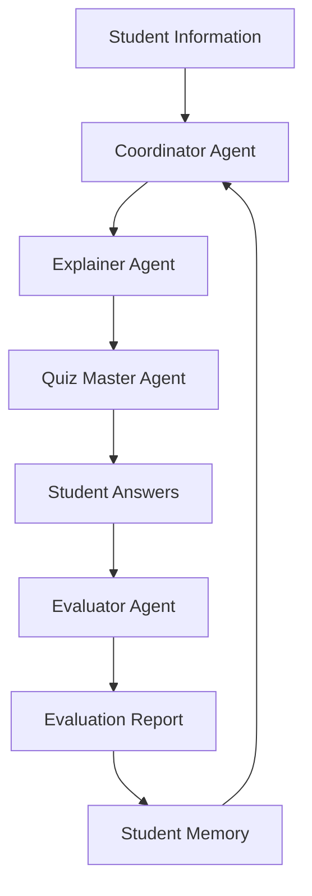

# LEO - Multi-Agent AI Tutor

An AI-powered personalized tutoring system built using CrewAI and Google Gemini. LEO uses multiple specialized AI agents to explain learning topics, generate quizzes, evaluate student answers, and maintain student learning history.

## Project Objectives

- Provide personalized learning experiences.
- Coordinate multiple specialized AI agents.
- Generate structured quizzes.
- Evaluate student answers and provide feedback.
- Maintain student learning history using JSON-based memory.

## Technologies Used

- Python
- CrewAI
- Google Gemini
- Streamlit
- JSON
- PyYAML
- python-dotenv

## AI Agents

| Agent | Responsibility |
|---|---|
| Coordinator Agent | Creates personalized learning plans. |
| Explainer Agent | Explains topics using simple language and examples. |
| Quiz Master Agent | Generates exactly five quiz questions with a separate answer key. |
| Evaluator Agent | Evaluates student answers and provides scores and feedback. |

## System Architecture



## Multi-Agent Orchestration

LEO uses CrewAI with a sequential orchestration process.

1. The Coordinator creates a personalized learning plan.
2. The Explainer receives the Coordinator's output and explains the topic.
3. The Quiz Master receives the explanation and generates a structured quiz.
4. The student submits answers through the Streamlit interface.
5. The Evaluator receives the quiz context and student answers, then generates an evaluation report.

## Memory System

The project uses a JSON-based memory system to maintain student learning history.

- Student name is used to retrieve individual learning history.
- Previous topics and evaluation results are stored.
- Previous learning history is passed to the Coordinator during subsequent sessions.
- Evaluation results are saved in `data/student_memory.json`.

## Project Structure

```text
leo_multi_agent_tutor/
│
├── agents/
│   ├── coordinator.py
│   ├── explainer.py
│   ├── quiz_master.py
│   └── evaluator.py
│
├── tasks/
│   ├── coordinator_task.py
│   ├── explanation_task.py
│   ├── quiz_task.py
│   └── evaluation_task.py
│
├── src/
│   ├── crew.py
│   ├── memory.py
│   └── feedback_loop.py
│
├── prompts/
│   └── prompts.yaml
│
├── data/
│   └── student_memory.json
│
├── app.py
├── .env
├── .env.example
├── .gitignore
├── requirements.txt
└── README.md
```

## Installation and Setup

### 1. Clone the Repository

```bash
git clone YOUR_GITHUB_REPOSITORY_URL
cd leo_multi_agent_tutor
```

### 2. Create a Virtual Environment

```bash
python -m venv venv
```

### 3. Activate the Virtual Environment

For Windows Git Bash:

```bash
source venv/Scripts/activate
```

### 4. Install Dependencies

```bash
pip install -r requirements.txt
```

### 5. Configure Environment Variables

Create a `.env` file in the project root:

```env
GEMINI_API_KEY=your_gemini_api_key
GEMINI_MODEL=gemini/gemini-3.8-flash
```

Use your own valid Gemini API key. Never upload the `.env` file to GitHub.

### 6. Run the Application

```bash
streamlit run app.py
```

Open the local Streamlit URL displayed in your terminal.

## Student Workflow

1. Enter student information.
2. Select a learning topic and level.
3. Start the learning session.
4. Read the AI-generated explanation.
5. Answer the five quiz questions.
6. Submit answers for evaluation.
7. Review the evaluation report and learning history.

## Configuration Notes

The application requires a working Gemini API connection. Model availability and API limits may affect live execution.

## Author

**Md. Sabbir Ahmed Siam**

LEO - Multi-Agent AI Tutor | Powered by CrewAI and Google Gemini